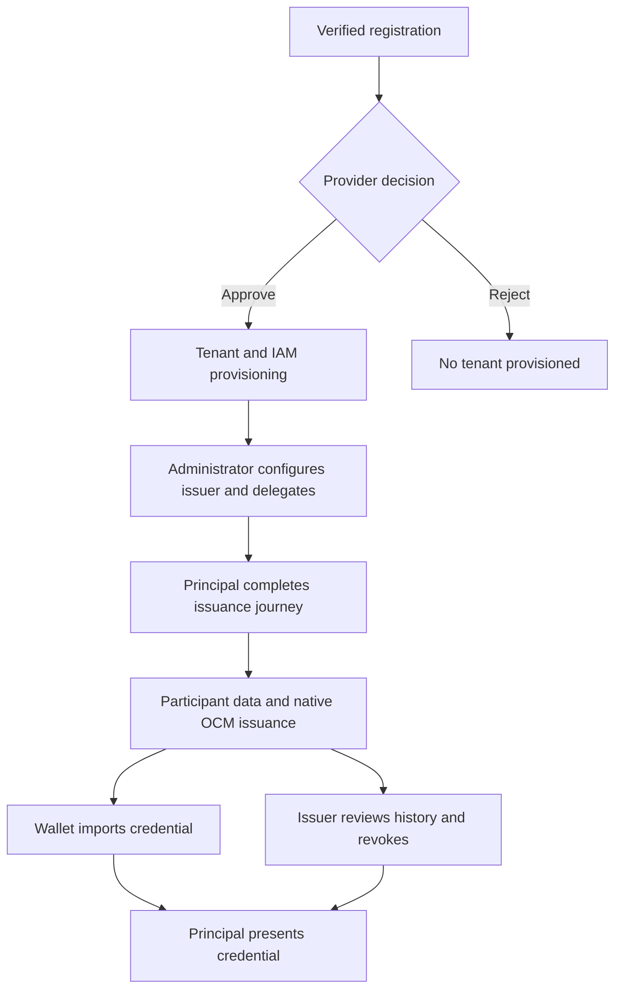

# Current release: 0.5.0-rc.12

PCI now decodes the native signer’s single-key JWK array and selects the configured key by algorithm before verifying the credential. This fixes the live credential-completion Algorithm/key mismatch failure. Earlier public JWKS, discovery, VM, metadata and Bash installer fixes are retained. See [docs/release/0.5.0-rc.12.md](docs/release/0.5.0-rc.12.md).

This neutral source revision replaces operator-specific identities and deployment values with documented examples. The wallet helper requires explicit target inputs. See [neutral configuration](docs/operations/neutral-configuration.md) and [revision validation](docs/release/neutral-validation.json).

# FACIS Principal Credential Issuance

**0.5.0-rc.12 — integration candidate.** PCI runs inside an existing XFSC ORCE instance with one Vue/uibuilder UI. It manages tenant onboarding, delegated issuer administration, credential configurations, request journeys and issuance history. Native OCM services handle offers, signing, metadata and status; a participant-owned Go/Goa service supplies credential data over mTLS gRPC.

This iteration targets OCM-WStack ESB 12.3.9: updated Crypto verification headers, independent status checks before credential delivery, strict presentation status verdicts, and bounded Helm-to-G0 ownership migration. It retains the rc.5 functionality and records the new source/build/live acceptance boundary. See [rc.6 changes](docs/release/0.5.0-rc.6.md) and [executed checks and remaining gates](docs/release/completion.md).



The [requirement matrix](docs/requirements/traceability.md) distinguishes delivered development from remaining build/live acceptance and public delivery. PCM, Entra, both clouds, accessibility, upstream image remediation and all-hop TLS still need real evidence. This is an integration candidate, not a sign-off declaration.
## Build and check

```bash
npm ci
python3 -m pip install PyYAML==6.0.2
npm run test:offline
```

Node.js 20+, Python 3/PyYAML and OpenSSL are required. The checked-in distribution is reproducible from source. Tests use real local cryptography and HTTP/2 mTLS, plus clearly identified database/upstream doubles. They do not replace cluster or wallet tests. See [validation](docs/release/validation.json).

## Deploy

For an already prepared PCI instance, use the [rc.12 artifact upgrade](docs/operations/upgrade-0.5.0-rc.12.md). For a new install read [deployment](docs/operations/deployment.md) and the [initial rc.6 setup](docs/operations/deploy-0.5.0-rc.6.md), then run `scripts/preflight.sh` and `scripts/deploy.sh` with the documented arguments. Helm 3.17+, Kubernetes 1.33–1.36, an existing ORCE instance and the selected OCM ESB 12.3.9 deployment are required. Replace all example hosts, paths and cluster values with the selected deployment's inputs.

The ORCE import surface stays:

- `dist/fap-pci-flow.json`
- `dist/ground-zero.sh`
- `dist/ui/`

For one non-interactive entrypoint use the [release runner or operator ORCE flow](docs/operations/automation.md). G0 prepares infrastructure. Import the flow and copy UI files afterwards; use a modified-flows deployment, not an ORCE restart. The participant service is a separate participant-owned reference, packaged under `reference/participant-data-repository/` with its chart under `deployment/helm/participant/`.

## Source layout

| Path | Purpose |
|---|---|
| `backend/functions/` | ORCE registration, IAM, tenancy and reconciliation |
| `backend/sr2/` | Issuer domain, native adapters, transport and persistence |
| `src/`, `shared/` | UI and public URL model |
| `automation/stage1/`, `scripts/` | G0, import, deployment, diagnostics and uninstall |
| `deployment/` | Helm charts and operator-owned prerequisite examples |
| `contracts/` | Protobuf, source pins and message contract records |
| `test/`, `.github/workflows/` | Offline tests, live PostgreSQL/BDD packs and CI |
| `docs/` | Architecture, operations, requirements and acceptance |

Test with the [participant setup](docs/testing/participant-test.md) and [ordered acceptance walkthrough](docs/testing/acceptance-walkthrough.md). See [rc.6 changes](docs/release/0.5.0-rc.6.md). Start with [issuer setup](docs/operations/issuer-runbook.md), [live acceptance](docs/testing/live-acceptance.md), and the [101-requirement matrix](docs/requirements/traceability.md). `mkdocs build` creates searchable documentation. No credentials, generated participant data, dependency directories or historical source archives are included.

Application source is Apache-2.0. Original specifications and vendored dependencies retain their notices. See [THIRD_PARTY_NOTICES.md](THIRD_PARTY_NOTICES.md) and [CONTRIBUTING.md](CONTRIBUTING.md).

Maintainer/contact assignment is pending the client's confirmation through the XFSC project leads. Use the designated project's issue process in [CONTRIBUTING.md](CONTRIBUTING.md), or [SECURITY.md](SECURITY.md) for sensitive reports. This candidate does not invent an official contact identity or mailbox.
