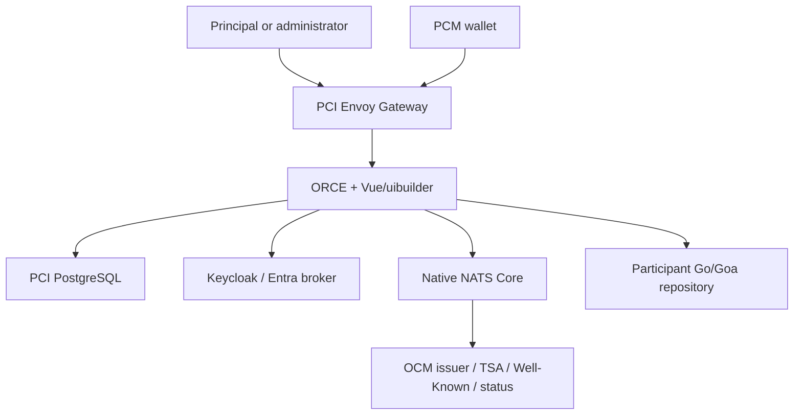

# Architecture

PCI runs in one existing ORCE/Node-RED process. G0 establishes prerequisites under operator credentials; the running flows use a bounded ServiceAccount. OCM is preinstalled and its Kubernetes lifecycle is outside PCI authority.

Tenant routing uses exact subdomains and a configurable ORCE base path. Envoy sets immutable tenant headers and strips reserved native-service headers. ORCE independently checks host, tenant ID, slug and current membership; a PCI ingress NetworkPolicy restricts direct backend access. Claims from a browser are never treated as trusted identity.

## Lifecycle

Registration → email verification → provider approval → desired tenant state → identity/configuration/HTTPRoute reconciliation → DNS readiness → active tenant. Approval does not synchronously provision infrastructure. Failures record safe condition codes and bounded operator diagnostics, not raw upstream payloads.

Issuer resources have independent UUIDs, revision numbers, immutable published snapshots and optimistic writes. Live publication advances its observed revision only after native metadata read-back. An issuance request pins configuration, connector, journey, metadata and key references. Later draft edits do not change it.

Tokens, offer correlation secrets, wallet nonce hashes and participant responses are process-local/transient. Database state contains configuration, membership, safe history and request/status references. Completed credentials are delivered to the wallet and discarded by PCI. This privacy design limits ORCE to one active replica; database locks alone do not distribute volatile NATS callbacks.

## Resource ownership

PCI owns its database/mail workloads, runtime config/secrets/RBAC, Gateway/routes/policies and participant-specific configuration in the PCI namespace. The pre-existing ORCE Deployment is patched once per changed runtime contract and its original specification is preserved privately. Helm owns PCI prerequisites; namespaces, CRDs, GatewayClass, one-shot jobs and the ORCE Deployment are excluded from that release.

Confirmed tenant deletion withdraws native metadata, disables issuance/sessions and removes owner-matching routes/configuration/identities, including public DID/JWKS/status resolution. Configuration archive within a live tenant is separate and preserves verification dependencies for previously issued credentials. Ownership and Kubernetes UID/resourceVersion preconditions prevent deleting a replaced resource.

[Native contract](../contracts/native-ocm.md) · [Participant protocol](../contracts/participant-protocol.md) · [Detailed issuer state](issuer-runtime.md)
